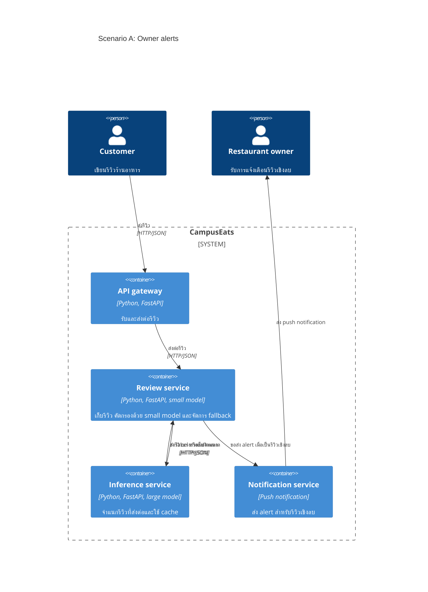

# Task 4: Deployment topologies and trade-offs

**Name / ชื่อ:** พีรวัส พิบูลย์วรกุล

**Student ID / รหัสนิสิต:** 6732033921

This is **individual work**: each student completes and submits their own copy, in their own fork.

_งานนี้เป็น**งานเดี่ยว** นิสิตแต่ละคนทำและส่งงานของตัวเอง ใน fork ของตัวเอง_

**Scenario (A, B or C) / Scenario ที่เลือก: A**

Choose **one** scenario below. If the last digit of your student ID is odd, take A or B; if it is even, take B or C. Use your measurements from Tutorial 6 as evidence: cite run names from `results/runs.csv`. Answer in Thai or English.

เลือก scenario **หนึ่ง** ข้อด้านล่าง ถ้าเลขตัวสุดท้ายของรหัสนิสิตเป็นเลขคี่ ให้เลือก A หรือ B ถ้าเป็นเลขคู่ ให้เลือก B หรือ C ใช้ผลการวัดจาก tutorial ที่ทำไปเป็นข้อมูลอ้างอิง โดยอ้างชื่อ run จาก `results/runs.csv` จะตอบเป็นภาษาไทยหรือภาษาอังกฤษก็ได้

Facts that hold in every scenario / ข้อเท็จจริงที่ใช้กับทุก scenario:

- The large model serves at most **20 calls per second** (4 calls at once × about 200 ms each), and every call costs money.

  _large model รับได้สูงสุด **20 calls ต่อวินาที** (พร้อมกัน 4 calls × ประมาณ 200 ms ต่อ call) และทุก call มีค่าใช้จ่าย_

- The small model is fast and cheap enough to run anywhere, including inside the review service or on a kiosk, but it is much less accurate on its own.

  _small model เร็วและถูกพอที่จะรันที่ไหนก็ได้ รวมถึงภายใน review service หรือบน kiosk แต่ถ้าใช้ตัวเดียวจะแม่นน้อยกว่ามาก_

## Scenarios

**A. Owner alerts.** When a customer posts a negative review, the restaurant owner gets a push notification within **2 seconds**. At the lunch peak, CampusEats receives **40 reviews per second**. A missed alert is acceptable, but a wrong alert (for example, "your customer is unhappy" when they are happy) makes owners stop trusting alerts and, in the end, ignore them.

_เมื่อลูกค้าโพสต์รีวิวเชิงลบ เจ้าของร้านจะต้องได้รับ push notification ภายใน **2 วินาที** เวลาช่วงพีคตอนเที่ยง CampusEats ได้รับรีวิวจำนวน **40 รายการต่อวินาที** การพลาด alert ไปบ้างนั้นยอมรับได้ แต่ alert ที่ผิด (เช่น "ลูกค้าไม่พอใจ" ทั้งที่จริงๆ แล้วพอใจ) จะทำให้เจ้าของร้านไม่เชื่อถือและเลิกสนใจ alert ในที่สุด_

**B. Canteen kiosk.** A tablet in each canteen lets students leave a review on the spot. However, the canteen Wi-Fi is poor: the tablets lose their connection several times a day, for minutes at a time. The system must accept every review, even while a tablet is offline. Restaurant owners need the labels **by the end of the day**.

\*มี tablet ในแต่ละโรงอาหารให้นิสิตรีวิวได้ทันที อย่างไรก็ดี การเชื่อมต่อ Wi-Fi ในโรงอาหารไม่ดี ทำให้ tablet หลุดการเชื่อมต่อวันละหลายครั้ง ครั้งละหลายนาที ระบบจะต้องรับรีวิวได้ทุกรายการแม้ขณะที่กำลัง offline อยู่ และเจ้าของร้านต้องการ label **ภายในสิ้นวัน\***

**C. Weekly report.** Restaurant owners want a weekly sentiment report. Nothing in producing this report has to be real-time. **Accuracy matters most** and **cost must be minimal**.

\*เจ้าของร้านต้องการรายงาน sentiment รายสัปดาห์ ไม่มีอะไรที่จะต้องทำแบบ real-time ในการออกรายงานนี้ ความแม่นยำ **(accuracy) สำคัญที่สุด** และ **ค่าใช้จ่ายต้องน้อยที่สุด\***

## Topologies and patterns to choose from / Topology และ pattern ที่เลือกใช้ได้

|     | Topology                        | Where the model runs / โมเดลรันที่ไหน                                                                                                           |
| --- | ------------------------------- | ----------------------------------------------------------------------------------------------------------------------------------------------- |
| T1  | Model as a service, synchronous | Inference service, called for each review (today's baseline) _inference service ถูกเรียกทุกรีวิว (baseline ของวันนี้)_                       |
| T2  | Model as a library              | Inside the review service, or on the device _ภายใน review service หรือบนอุปกรณ์_                                                             |
| T3  | Hybrid                          | Small model locally, large model as a remote service _small model รันในเครื่อง large model เป็น remote service_                              |
| T4  | Asynchronous / batch            | Reviews are queued (broker, W10) or stored, and scored later in bulk _รีวิวถูกเข้าคิว (broker, W10) หรือเก็บไว้ แล้วติด label ทีหลังเป็นชุด_ |

Combine one topology with any of the patterns from Tutorial 6: **fallback**, **cascade** and **cache**.

\*เลือก topology หนึ่งแบบ แล้วผสมกับ pattern จาก Tutorial 6 ได้ตามต้องการ: **fallback**, **cascade** และ **cache\***

## 1. Quality requirements

The three most important quality requirements for your scenario, each with a number where possible.

_quality requirements ที่สำคัญที่สุด 3 ข้อของ scenario ที่เลือก ระบุตัวเลขเมื่อทำได้_

| #   | Quality    | Requirement                                                                                                                                                             |
| --- | ---------- | ----------------------------------------------------------------------------------------------------------------------------------------------------------------------- |
| 1   | Latency    | เมื่อมีการแจ้งเตือนรีวิวเชิงลบ เจ้าของร้านต้องได้รับ notification ภายใน 2 วินาทีหลังระบบได้รับรีวิว ตามที่ scenario กำหนด โดย scenario ยอมรับให้พลาด alert บางรายการได้ |
| 2   | Throughput | ระบบต้องรองรับรีวิวช่วงพีคได้ 40 รายการต่อวินาที ตามที่ scenario กำหนด                                                                                                  |
| 3   | Precision  | อย่างน้อย 95% ของ alert ที่ส่ง ต้องเป็นรีวิวเชิงลบจริง เพื่อลดการแจ้งเตือนผิด โดย 95% เป็น เป้าหมายที่เสนอเอง ไม่ใช่ตัวเลขที่ scenario กำหนด                            |

## 2. Design / การออกแบบ

Your topology, the patterns you add, and a container-level diagram (C4 level 2). The C4 diagram must be written in Mermaid.

_topology ที่เลือก pattern ที่เพิ่ม และ diagram ระดับ container (C4 level 2) เขียนด้วย Mermaid_

**Topology:** T3 — Hybrid: small model ทำงานภายใน review service และ large model ทำงานผ่าน inference service

**Patterns:** ใช้ cascade ที่ threshold 0.6 คัดกรองรีวิวและส่งบางส่วนไปยัง large model โดย cache ใน inference service ช่วยเฉพาะรีวิวที่ส่งมาถึง service นี้ เมื่อเรียก large model ไม่สำเร็จ fallback จะเก็บสถานะ `PENDING` โดยยังไม่ส่ง alert และเสนอให้นำกลับมาประมวลผลภายหลัง หากประมวลผลเสร็จหลังผ่านไป 2 วินาที ให้บันทึก label ไว้ดูย้อนหลัง แต่ไม่ส่ง push alert ล่าช้า

**ข้อจำกัดที่ต้องตรวจสอบ:** การส่งต่อด้วย confidence ไม่ได้รับประกัน precision ต้องวัดด้วยข้อมูลที่มี label จริง และต้องวัดเวลาจน push notification ถึงเจ้าของร้าน รวมถึงอัตราเรียก large model ที่ช่วงพีคเทียบกับ capacity 20 calls/second ทั้ง hybrid topology และ notification service เป็น design ที่เสนอ ยังไม่ได้ทดสอบโดยตรงในการทดลองปัจจุบัน

## 3. Evidence / หลักฐาน

Which runs support your choice? Show the numbers and, for scenario A, the capacity arithmetic: how many large-model calls per second does your design need at the peak?

_run ไหนที่สนับสนุนการตัดสินใจของนิสิต ให้นิสิตแสดงตัวเลขประกอบ และสำหรับ scenario A ให้นิสิตแสดงการคำนวณ capacity ด้วย เพื่อแสดงว่าในช่วงพีคนั้น design ของนิสิตต้องใช้ large model กี่ calls ต่อวินาที_

| Run                        | What it shows / แสดงอะไร                                                        |
| -------------------------- | ------------------------------------------------------------------------------- |
| `t2-0.6`                   | Cascade ไม่เปิด cache: accuracy 91.5%, p95 522 ms, large calls 38%              |
| `t3-cache` (threshold 0.6) | Cascade เปิด cache: accuracy 91.5%, p95 536 ms, large calls 31%, cache hits 36% |
| `t1-before`                | ที่ hang rate 10% ก่อน fallback: 22 errors จาก 200 คำขอ                         |
| `t1-after`                 | ที่ hang rate 10% หลัง fallback: 0 errors และ 27 PENDING จาก 200 คำขอ           |

**Capacity ช่วงพีค:** หากสมมติว่าสัดส่วน large calls เท่ากับที่วัดใน `t3-cache` ที่ threshold 0.6, 40 รีวิว/วินาที × 31% = **12.4 large calls/วินาที** ซึ่งต่ำกว่า capacity 20 calls/วินาที ส่วน `t2-0.6` ที่ไม่เปิด cache ได้ 40 × 38% = **15.2 calls/วินาที**

การคำนวณนี้เป็นการประมาณเท่านั้น: `t3-cache` วัด cache ก่อน cascade แต่ design ที่เสนอตรวจ cache หลัง small model จึงนำ 31% หรือ cache hits มาใช้ยืนยัน capacity ของ design นี้โดยตรงไม่ได้ ต้องทดสอบ design ที่เสนอกับ workload ช่วงพีคเพิ่มเติม ค่า p95 ไม่รวมการยืนยันเวลาจน push notification ถึงเจ้าของร้าน และ accuracy รวมไม่ยืนยัน precision ของ alert

## 4. ADR

Use the ADR format from W5.

_ใช้รูปแบบ ADR จาก W5_

**Title:** เลือก Hybrid topology สำหรับแจ้งเตือนรีวิวเชิงลบ

**Status:** Proposed

**Context:** CampusEats ต้องแจ้งเตือนเจ้าของร้านภายใน 2 วินาทีเมื่อได้รับรีวิวเชิงลบ และรองรับรีวิวช่วงพีค 40 รายการต่อวินาที การแจ้งเตือนผิดทำให้เจ้าของร้านเสียความเชื่อถือ ขณะที่การพลาด alert บางรายการยอมรับได้ Large model รองรับได้สูงสุด 20 calls ต่อวินาที และมีค่าใช้จ่ายทุกครั้งที่เรียก

**Decision:** เสนอใช้ T3 Hybrid โดยให้ small model อยู่ใน review service และเรียก large model ผ่าน inference service ใช้ cascade ที่ threshold 0.6 คัดกรองรีวิวและส่งบางส่วนไปยัง large model พร้อมใช้ cache ใน inference service สำหรับผลของรีวิวที่ส่งมาถึง service นี้ หากเรียก large model ไม่สำเร็จ ให้เก็บรีวิวเป็น PENDING โดยยังไม่ส่ง alert และเสนอให้นำกลับมาประมวลผลภายหลัง หากเสร็จหลัง 2 วินาทีให้บันทึก label ไว้ดูย้อนหลัง แต่ไม่ส่ง push alert ล่าช้า

**Consequences:**

- Positive: Cascade และ cache อาจช่วยลดการเรียก large model โดย run t3-cache ที่ threshold 0.6 ใช้ large model 31% เทียบกับ 38% ใน t2-0.6 ที่ไม่เปิด cache และทั้งสอง run มี accuracy รวม 91.5%
- Negative: การคัดกรองด้วย confidence ไม่รับประกัน precision และรายการ PENDING ที่เสร็จหลัง 2 วินาทีจะไม่ได้รับ push alert ตำแหน่ง cache ใน design นี้ต่างจาก run t3-cache จึงต้องทดสอบอัตรา large calls ใหม่ รวมถึงทดสอบเวลาจน push notification ถึงเจ้าของร้านและการรองรับ 40 รีวิวต่อวินาที

**Alternatives considered:** T1 — เรียก large model ทุกรีวิวแบบ synchronous: ไม่เลือกเป็นแนวทางหลัก เพราะที่ช่วงพีค 40 รีวิวต่อวินาทีจะต้องใช้ประมาณ 40 calls ต่อวินาที ซึ่งเกิน capacity 20 calls ต่อวินาทีของ large model และทุก call มีค่าใช้จ่าย

>
